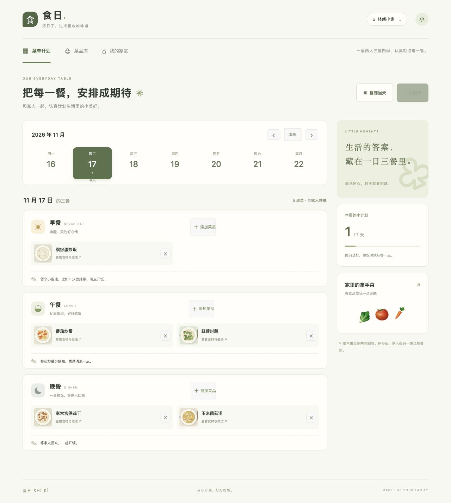

# 验收记录

检查日期：2026-11-17。

## 已完成

| 检查 | 结果 |
|---|---|
| npm 依赖安装、Prisma 客户端生成 | 通过，已生成 package-lock.json |
| `npm run typecheck` | 双端前端、后端、示例导入和测试代码通过 |
| `npm run build` | 后端 TypeScript、H5、微信小程序均构建成功 |
| 带 `TEST_DATABASE_URL` 的 `npm test` | 24 项通过，0 项失败，0 项跳过，包含真实 PostgreSQL API 集成测试 |
| Docker PostgreSQL | `postgres:17-alpine` 拉取成功，`menu-miniprogram-db-1` 健康运行，本机 127.0.0.1:5432 |
| 数据库初始化 | `202611170001_init` 迁移及开发示例数据导入成功 |
| 初始 SQL 与 Prisma 模型比对 | 使用 `prisma migrate diff --from-empty` 比对，内容一致 |
| 本地 API 启动 | localhost:3000 正常启动，登录方式查询返回 200，未登录访问 /me 返回 401 |
| 浏览器登录页面 | 正常渲染，微信未配置入口禁用，开发体验入口显示 |
| 开发账号与示例菜单 | 小满登录成功，林间小家及当日 5 道菜正常展示，重新打开页面保留会话 |
| 网页菜单保存与刷新 | 早餐备注编辑、保存、刷新后读回成功；验收后还原原有空备注并保存 |
| 390px / 1440px 登录页布局 | DOM 检查确认页面宽度等于视口宽度，无横向溢出 |

通过的测试覆盖真实日期校验、餐内重复菜品、历史快照保留、下架菜不可新增到其他餐次、角色检查、图片签名、生产模拟登录禁用，以及 HTTP 未授权请求、来源校验、微信 state 校验、错误信息脱敏和登录限流。真实数据库测试另覆盖家庭隔离、邀请幂等及失效、菜品默认下架与跨家庭分类校验、计划持久化、并发版本冲突、复制覆盖确认、图片上传权限、管理员授予撤销和会话注销。

网页保存验收截图：

## 尚未完成

- 家庭创建、邀请、菜谱 CRUD、菜单复制等行为已通过真实数据库 API 集成测试，但对应浏览器交互尚未逐项端到端验收。
- 微信开发者工具导入、真机布局与上传尚未验收；构建成功不等于真机通过。
- 正式微信扫码、小程序登录、双端 UnionID 关联与 S3 上传需要真实配置后验证。
- 依赖修复后安装审计仍报告 41 项告警（13 moderate、28 high），主要涉及框架及工具链传递依赖；详情与发布边界见 [安全说明](SECURITY.md)。未报告“无漏洞”。

数据库、迁移与示例数据已准备好，可在 http://localhost:5173 使用“小满”（所有者）或“阿远”（成员）开发昵称体验。正式发布前继续完成部署说明中的手工清单及上述未验收项。
